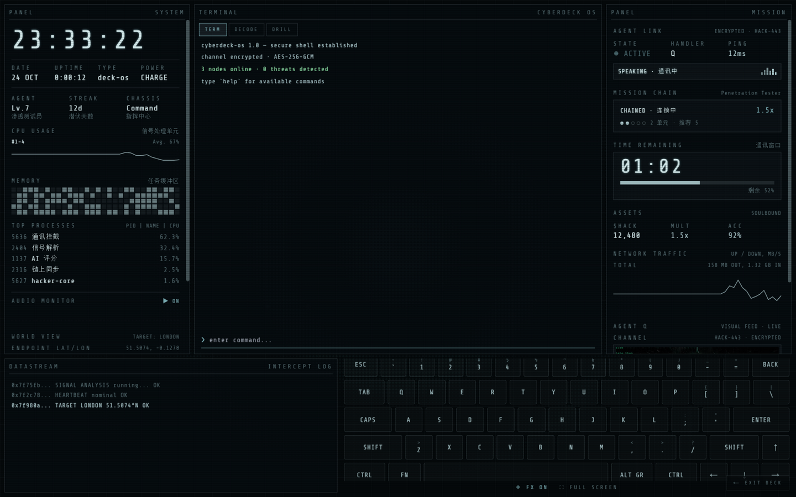
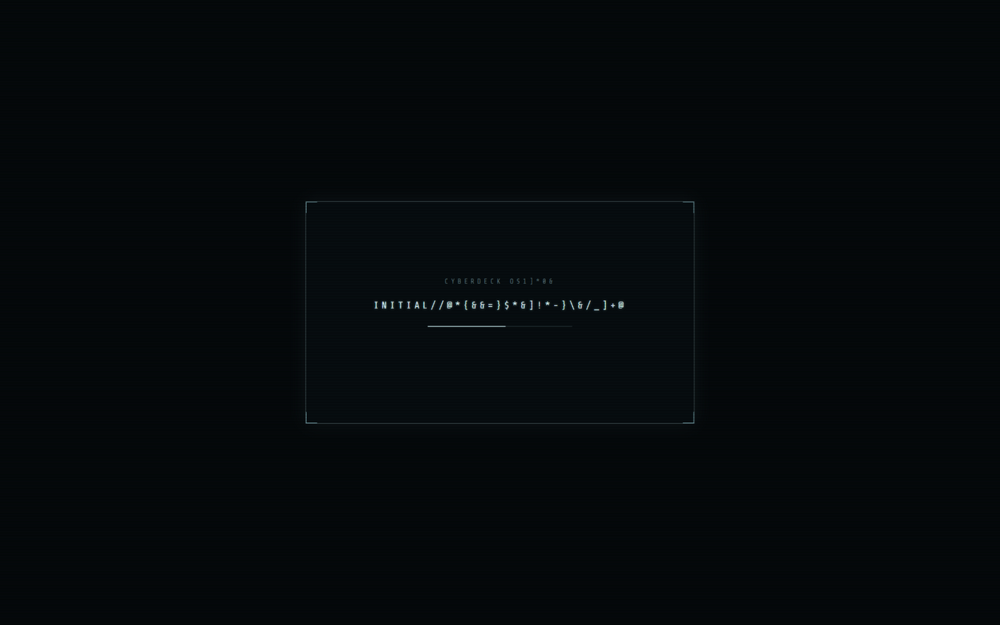
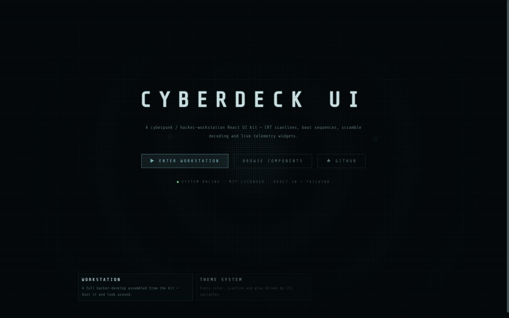
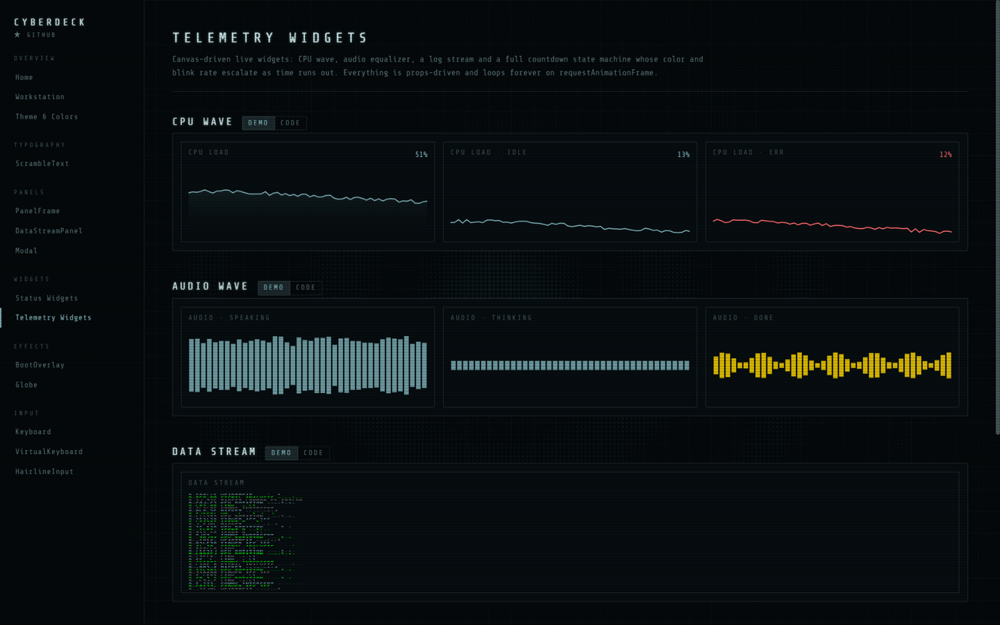
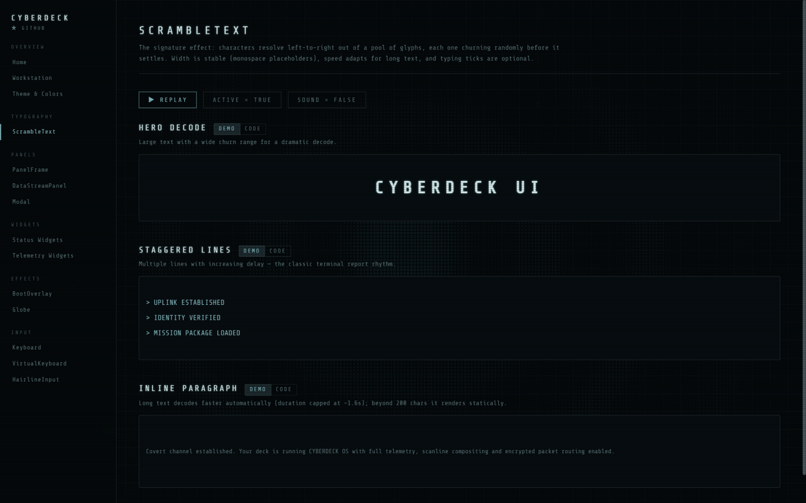

<div align="center">

# Cyberdeck UI

**A cyberpunk / hacker-workstation React UI kit — CRT scanlines, boot sequences, scramble decoding and live telemetry widgets.**

[](./LICENSE)
[](./.github/workflows/ci.yml)

[中文文档](./README.zh-CN.md)

</div>

---

Build an eDEX-UI-flavored interface in minutes: a hacker-desktop with system
telemetry, an interactive terminal, wireframe globes, CRT overlays and a full
boot-sequence performance. Every component is React 18 + Tailwind,
props-driven, zero business logic and zero heavy dependencies (no three.js,
no framer-motion, no state library).

<div align="center">
  
</div>

<p align="center"><sub>The full workstation — system telemetry · interactive terminal · mission panel · datastream · keyboard</sub></p>

## Features

- **Full workstation demo** — a complete hacker-desktop (system panel, interactive terminal, mission panel, datastream, mechanical keyboard), one click away from the landing page (`/workstation`).
- **20+ components** — `ScrambleText`, `BootOverlay`, `PanelFrame`, `Globe`, `CPUWave`, `AudioWave`, `DataStreamPanel`, `TaskCountdown`, `Keyboard`, `AgentQ`, `Modal` and more, each with a live playground (demo ↔ code toggle).
- **CSS-variable theme** — every color, glow and hairline is a variable; re-tint the whole kit by overriding `:root`.
- **Zero-dependency components** — only `react` + `clsx`; graphics hand-drawn on canvas, sounds synthesized with Web Audio (no audio assets required).
- **Mobile-aware** — dvh viewport handling, touch adaptations, responsive workstation layout.

## Screenshots

| Boot sequence | Landing |
| --- | --- |
|  |  |

| Playground · Telemetry | Playground · ScrambleText |
| --- | --- |
|  |  |

## Quick start

```bash
npm install
npm run dev
# open http://localhost:3000
```

- `/` — landing page with the signature boot sequence
- `/workstation` — the full hacker-workstation demo
- `/components/*` — per-component playgrounds

## Using the components

Copy what you need — components are self-contained under `frontend/src`:

```
src/
├── app/globals.css            # the whole design system (CSS variables + utilities)
├── components/
│   ├── widgets/               # dashboard widgets (Clock, Funds, CPUWave, ...)
│   ├── edex/                  # panels & effects (PanelFrame, ScrambleText, BootOverlay, ...)
│   └── workstation/           # the assembled workstation demo panels
└── lib/                       # optional helpers: sfx engine, fx/fullscreen toggles
```

```tsx
import { PanelFrame } from "@/components/edex/panel-frame";
import { ScrambleText } from "@/components/edex/scramble-text";

<PanelFrame leftLabel="SYSTEM" rightLabel="DECK-07">
  <ScrambleText text="ALL SYSTEMS NOMINAL" speed={40} />
</PanelFrame>
```

Wrap your page root with the `booted` class to drive the staggered
`.boot-seq` / `.key-in` entrance animations, and add `edex-scanlines hacker-bg`
to `<html>` for the CRT + grid backdrop.

## Component index

| Group | Components |
| --- | --- |
| Typography | `ScrambleText` (glyph-decode typewriter) |
| Panels | `PanelFrame`, `DataStreamPanel`, `Modal` (popup / intro variants) |
| Status widgets | `Clock`, `NetworkStatus`, `SystemStatus`, `Funds`, `ProcessTable`, `NFTCard`, `AgentQ` |
| Telemetry | `CPUWave`, `AudioWave`, `DataStream`, `TaskCountdown`, `LineGraph` |
| Effects | `BootOverlay`, `Globe`, `ShaderBackground` (WebGL) |
| Input | `Keyboard`, `VirtualKeyboard`, `.hairline` input pattern |

Playgrounds: see `frontend/src/app/components/*` — each page has live demos
plus the source snippet behind them.

## Project structure

```
27_CyberdeckUI/
├── docs/            # plan & implementation notes (Chinese)
├── frontend/        # Next.js 14 showcase + component library
└── LICENSE          # MIT (with eDEX-UI attribution)
```

## Live demo

The workstation this kit was extracted from runs live at [www.hackerenglish.com](https://www.hackerenglish.com) — the whole interface (boot sequence, panels, widgets, keyboard) is the original application of these components.

## License

[MIT](./LICENSE) — the visual language is inspired by, and partially derived
from, [eDEX-UI](https://github.com/GitSquared/edex-ui) (MIT). The bundled
Share Tech Mono font is licensed under the SIL OFL.
